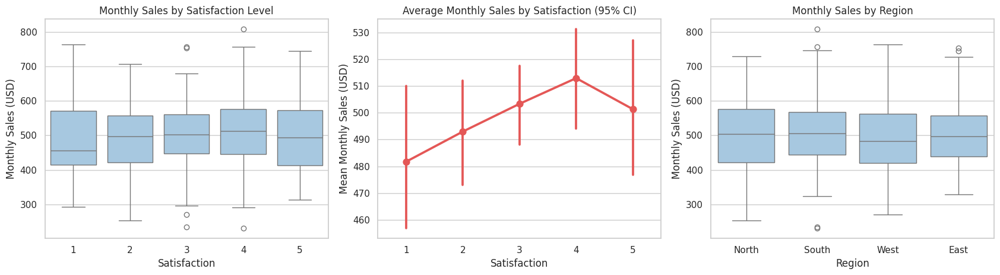
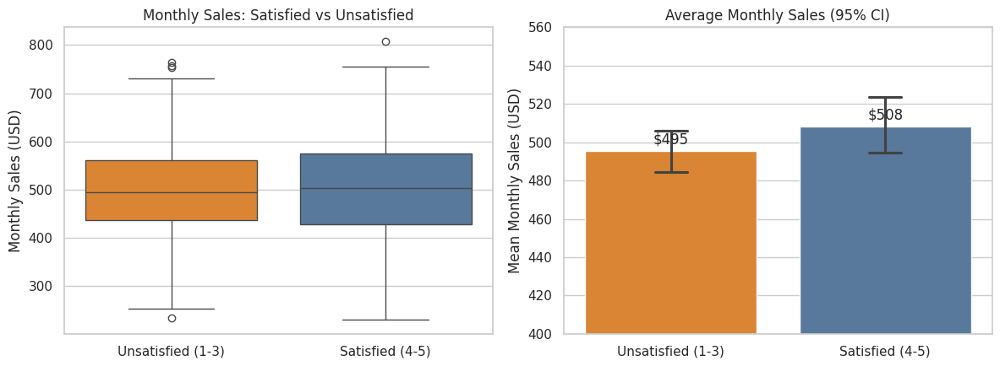
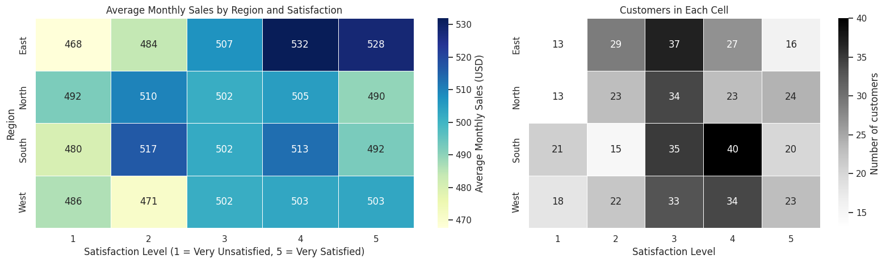
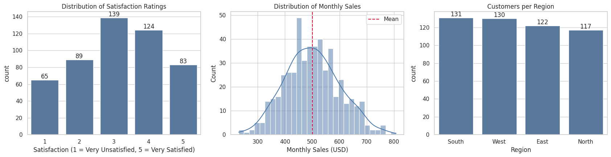
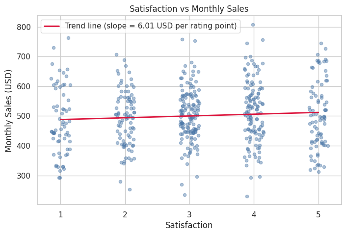
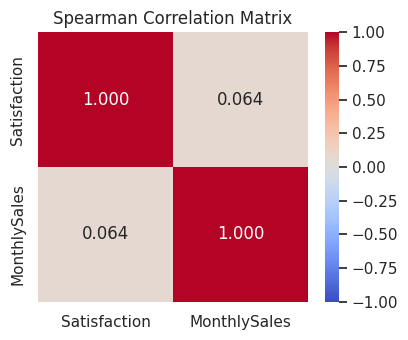

# Customer Satisfaction vs. Sales: A Statistical Analysis

**Do more satisfied customers generate higher monthly sales?** This project tests that question on 500 customers using descriptive statistics, correlation analysis, hypothesis testing, and visualization in Python.


📓 **[View the full notebook →](notebooks/customer_satisfaction_sales_analysis.ipynb)**

---

## TL;DR

| | Result |
|---|---|
| **Question** | Does customer satisfaction (1–5) predict monthly sales? |
| **Answer** | **No, not reliably.** The link is very weak and not statistically significant. |
| **Correlation** | Pearson r = 0.075 (p = 0.09), Spearman ρ = 0.06 (p = 0.15). Satisfaction explains **< 1%** of the variation in sales. |
| **Satisfied vs. unsatisfied** | Satisfied customers (4–5) spend **$12.90/month more** on average, but Welch's t-test gives p = 0.17 and Cohen's d = 0.13 (negligible effect). |
| **Business takeaway** | Satisfaction scores alone shouldn't be used to forecast sales. Other drivers (pricing, product mix, customer size) are likely more important. |

---

## Skills Demonstrated

- **Data validation:** checks for missing values, duplicates, and out-of-range ratings
- **Exploratory data analysis:** summary statistics, skewness/kurtosis, frequency tables, group comparisons
- **Correlation analysis:** Pearson, Spearman, and Kendall, chosen for an ordinal predictor
- **Hypothesis testing:** independent t-tests (Student and Welch), with assumption checks (Levene, Shapiro-Wilk)
- **Effect size and uncertainty:** Cohen's d and 95% confidence intervals, beyond p-values alone
- **Multiple-comparison awareness:** Bonferroni correction applied to region-level tests
- **Data visualization:** distributions, box plots, CI plots, regression trend lines, heatmaps
- **Communication:** findings written up in plain language with business implications and limitations

---

## Key Visuals

**Monthly sales by satisfaction level and region.** Groups overlap heavily, with no clear upward trend.


**Satisfied vs. unsatisfied customers.** The 95% confidence intervals overlap, so the difference is not significant.


**Average sales by region × satisfaction.** East shows a slight upward tilt, but it does not survive Bonferroni correction.


<details>
<summary>More charts</summary>





</details>

---

## Dataset

500 customer records ([`data/customer_data.csv`](data/customer_data.csv)). No missing values or duplicates.

| Column | Type | Description |
|---|---|---|
| `CustomerID` | Identifier | Unique customer ID |
| `Satisfaction` | Ordinal (1–5) | 1 = Very Unsatisfied, 5 = Very Satisfied |
| `MonthlySales` | Numeric (USD) | Monthly sales per customer (mean ≈ $501, SD ≈ $101) |
| `Region` | Categorical | North, South, East, West |

---

## Methodology

1. **Problem definition:** frame the business question and hypotheses (α = 0.05)
2. **Data validation:** check structure, types, missing values, duplicates, and valid ranges
3. **EDA:** descriptive statistics and distributions, broken down by satisfaction level and region
4. **Correlation:** Pearson (linear) plus Spearman and Kendall (rank-based, suited to ordinal data)
5. **Hypothesis test:** Satisfied (4–5) vs. Unsatisfied (1–3). Levene's test showed unequal variances, so **Welch's t-test** is the primary result
6. **Segment analysis:** Region × Satisfaction heatmap and per-region correlations with Bonferroni correction
7. **Conclusion:** plain-language findings, business recommendations, and limitations

---

## Repository Structure

```
├── data/
│   └── customer_data.csv                          # Raw dataset (500 rows)
├── notebooks/
│   └── customer_satisfaction_sales_analysis.ipynb # Full analysis, step by step
├── images/                                        # Charts exported from the notebook
├── requirements.txt                               # Python dependencies
└── README.md
```

---

## How to Run

**Option 1: Google Colab (no setup).** Open the notebook in Colab and upload `data/customer_data.csv` when prompted.

**Option 2: Locally**
```bash
git clone https://github.com/Muhammed-J-gif/Analyzing-Customer-Satisfaction-and-Sales-Trends-.git
cd Analyzing-Customer-Satisfaction-and-Sales-Trends-
pip install -r requirements.txt
jupyter notebook notebooks/customer_satisfaction_sales_analysis.ipynb
```
The notebook loads the dataset from `data/` automatically.

---

## Limitations and Next Steps

- **Observational data:** even a real association would not prove that satisfaction *causes* sales.
- **Self-reported 1–5 ratings** are coarse, and some Region × Satisfaction cells contain only 13–16 customers.
- **Next steps:** add likely sales drivers (pricing, product mix, tenure, customer size), collect a larger sample or longitudinal data, and model sales with multiple regression.

---

## Author

**Muhammed J.** · [GitHub](https://github.com/Muhammed-J-gif)
